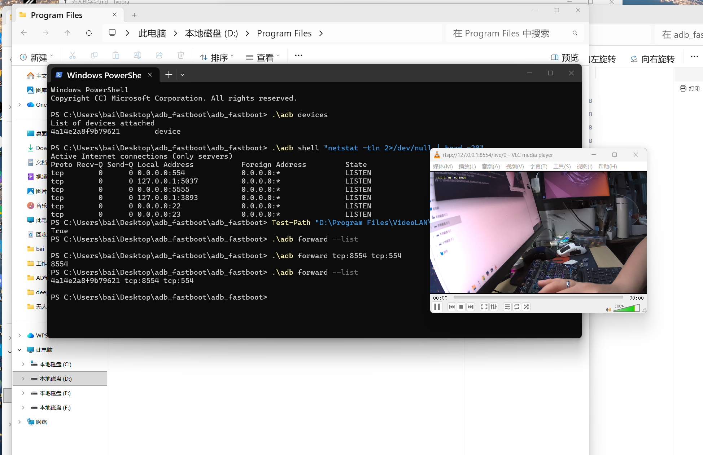

# 2026

## 10.12

1.我从"遥控器配不上"开始排查，通过官方说明书核对、接收机 WiFi 页对比、以及"能配另一台接收机的3.3.0版本固件"的对照实验，最终确认根因是接收机固件制式 `ISM2G4` 与遥控器 `CE_LBT` 不兼容，以及本固件为3.2.0；随后尝试用 Configurator 刷成 LBT，

后半夜（上面方法不要用，用下面方法刷固件）

>   [ ExpressLRS官网](https://www.expresslrs.org/)

-   刷写固件成功

    

## 10.13

1.固件制式选错，重新进入`elrs官网`.下载`LBT`的

-   （可能跟这个没关系，是因为这个没有物理按键，而是通过快速断电三次进入绑定模式时候没弄好。理解成第四次才通电）

2.

- 格普 Nano SE 没有物理按键，通过**快速通断电 3 次**进入绑定模式：
    -   通电→立刻断电→通电→立刻断电→第三次保持通电，节奏要快
    -   指示灯出现双闪节奏，即进入绑定状态
    -   用遥控器执行绑定操作，几秒后灯常亮即成功

3.遥控器和接收机配对成功

4.地面站测试完成，未装桨叶起飞，离地测试

## 10.22

1.炸鸡心得：

因为上次飞起来有点吃力，然后准备将2s换成4s，之前2s油门推满没有烟花，是因为没有到达极限阈值，算是运气好，后续应该注意！并且地面站要设置好阈值上线

-   用的格普 F411 20A AIO + 4S 650mAh 欧牌电池，**没装桨、油门直接推满**
    -   无桨空载飞，电机空载电流异常冲高
    -   ：20A AIO 一体板，**过流保护很弱**
        -   廉价一体 AIO 的硬件限流不是硬切断，靠固件保护，保护反应慢。满油门一瞬间电流尖峰来得极快，固件还没来得及降油门，MOS 管就已经热击穿短路。 一旦 MOS 击穿，相当于电池正负极直接短路，**4S 锂电池瞬间巨大短路电流 → 板子起火、电池快速发烫**，就是你看到烧起来的现象。

**重要提醒**：**任何情况禁止无桨满油门**!!!!!

-   以后测试铁律：**任何时候，不装桨，绝对不要推高油门！只可以非常轻点油门低速点动测试转向**

## 10.29

1.今天把 RV1103（Luckfox Pico）从零跑通了。（视觉平台搭建）

-   先是用 SocToolKit 的 SD 卡工具把 Buildroot 镜像烧进 32G TF 卡，七次分区全部写入成功；

-   上电后接串口（CH340，115200）能登录。做了基础自检：可用内存 20MB 左右（64MB 里有 24MB 给了摄像头）、根分区 5.8G（默认没扩容）、

-   摄像头识别出 video0~2 和 rkipc.ini。

    -   Linux 有个规矩：**一切皆文件**。硬件设备也会变成 `/dev/` 目录下的一个文件。
    -   /dev/video0	主码流	高清，给录像/推流用
    -    /dev/video1	子码流	低分辨率，给第二路显示 
    -   /dev/video2	第三路 / JPEG	抓图用

-   最后用 adb 端口转发把板子上 554 端口的 RTSP 流拉到电脑，VLC 上看到了实时画面，30fps / 11Mbps，这条“摄像头→ISP→编码→推流”的链路算是通了。

    

-   中间踩了几个坑：串口模块一开始认不出来（换了个 USB 口才好）、板子开机后 rkipc 一直刷运动检测日志把串口刷爆（用 RkLunch-stop.sh 或干脆走 ADB 绕开）、还有个 image.bmp 以为是摄像头抓的图，结果打开是 Rockchip 的 logo。

    

    2.下一步是在 Ubuntu 上编 SDK 和 RKNN 的 YOLOv5 demo，把这套视觉链路真正跑起来。

## 10.31

**今日完成**

-   Ubuntu 22.04 上装好了 SDK 和交叉编译链
-   编译出了 ARM 32 位 YOLOv5 demo
-   整个 demo 成功推到 RV1103 并跑起来
-   NPU 推理链路通了，终端能看到 `person`、`dog`、`keyboard` 等检测结果

`luckfox_pico_yolov5_demo`**这个 demo 能跑起来，就说明视觉链路是通的。** 摄像头、ISP、NPU、RKNN 全部验证过了。

**下次任务**

-   `RkLunch-start.sh` 或 `reboot` 恢复 RTSP

-   VLC 看原始画面，确认摄像头正常

-   再决定是继续改代码显示检测框，还是开始训练自己的模型
